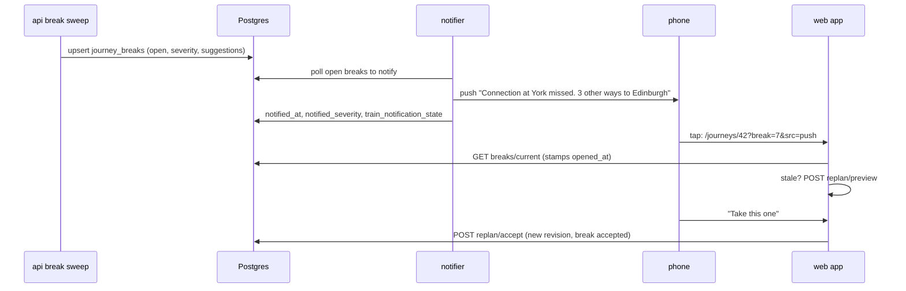

# Mid-journey train changes and auto-suggest (2026-10-22)

Status: design, awaiting sign-off on §14 before implementation. Work log
DS-128.

The request, from the user, in short:

- Choosing an alternative for a missed leg must be easy. The leg may be
  missed through the user's own lateness, or because an earlier leg was
  late or cancelled. It must be a lighter "choose an alternative" flow, not
  full leg editing.
- Replacing a leg must never destroy what was booked or planned. The
  older plan is kept for Delay Repay and for history, especially when a
  train is cancelled.
- When an earlier leg changes, later legs are updated, or updates are
  suggested.
- New suggestions appear by themselves whenever a journey stops working:
  a connection missed on live times and minimum connection times (MSN), a
  cancellation, or the user marking a train as missed.
- **The headline, early-phase feature is proactive auto-suggest
  notifications.** When a journey breaks, a push (or in-app notice)
  deep-links straight to suggestions already computed for that journey.
  It must:
  - send one notice per break, re-notify only if things get worse, go
    quiet once the user acts, and stay inside the one-push-per-user-per-
    train rule;
  - re-plan on open when the suggestions are stale;
  - offer a one-tap accept that keeps the original plan for Delay Repay;
  - have an opt-out;
  - be measured: sent, opened and accepted.

Builds on:

- `2026-09-22-journey-tracking-design.md` (journeys and legs);
- `2026-09-28-trips-plan-live-overlay-design.md` (the live overlay this
  design reuses as its feasibility engine);
- `2026-10-20-untracked-legs-and-tracked-train-states-design.md` (Tube,
  bus and walk legs);
- DS-93, "Change train drops the old train" (`release_leg_subscription`,
  migration `20261021120000`);
- `2026-10-21-tracked-trains-as-journeys-design.md` (DS-124, in flight:
  every tracked train becomes a one-leg journey);
- `2026-10-21-pre-departure-prediction-design.md` (DS-123, a later input
  for "at risk");
- `2026-10-14-ds-mcp-delegated-access-design.md` (delegated clients).

Contents: §1 what exists today, §2 problem and user stories, §3 decisions,
§4 data model, §5 feasibility engine, §6 auto-suggest notifications, §7
API, §8 UX, §9 Delay Repay, §10 migrations and backfill, §11 edge cases,
§12 phasing, §13 risks, §14 open questions, §15 tests, §16 metrics.

## 1. What exists today

All paths are from the repository root, at `origin/main` 097fd582.

### 1.1 Journeys, legs and trains

| Thing | Where | Today |
|---|---|---|
| `journeys` | `crates/ds-store/migrations/20260922090000_journeys.sql` | `id`, `user_id`, `custom_name`, timestamps, later `source_template_id` and `created_via` (`20261015010000_delegated_access.sql`). |
| `journey_legs` | same file, plus `20260925090000` (`window_searched`), `20261020150000_journey_legs_untracked.sql` (`kind`, `transit_mode`, places, `planned_departure`/`planned_arrival`) | `UNIQUE (journey_id, leg_order)`. `train_subscription_id` FK `ON DELETE SET NULL`. `match_mode` is `unmatched`, `manual` or `auto`. No status, no "missed", no history. |
| `train_subscriptions` | `20260828120000_train_tracking.sql` (as `tracked_trains`), `20260906100000_trains.sql` | Per user, per train (`trains_id`). Idempotent per `(user_id, trains_id)` in code, under `common::pg::lock_user_train_subscription`, not by a unique index. `notifications_enabled` is internal only. `tracked_standalone` (DS-93) goes away under DS-124. |
| `tracked_train_tickets` | `20260829090000_journey_ticket_tracking.sql` | Tickets hang off the **subscription** (`tracked_train_id`), not the leg. |
| `group_journeys` | `20260922110000` | Journey shares. Train shares are `group_trains`. |

**Change train overwrites the leg in place.** `POST
/Journeys/{j}/legs/{l}/train` (`post_leg_train`,
`crates/api/src/routes/journeys.rs`) calls
`create_subscription_and_bind_leg_with_search`
(`crates/api/src/data/journeys.rs`). In one transaction it finds or
creates the new subscription, then `set_leg_train_subscription_locked`
runs `UPDATE journey_legs SET train_subscription_id = $1, match_mode =
'manual'` (and, with `search`, rewrites the leg's stations, date and
window). Then `release_leg_subscription(old, move_to = Some(new))` moves
the old row's tickets and `group_trains` to the new row and **deletes**
the old row unless another leg (or, until DS-124 Phase 2,
`tracked_standalone`) keeps it. Nothing records which train the leg had
before. So today a Change train after a cancellation loses the booked
train, and the Delay Repay estimate then describes the replacement
train, not the booked journey.

**"Change train" is hidden on most legs.** `JourneyLegCard.tsx` gates the
button on `hasWindow = leg.windowSearched`. `window_searched` is `TRUE`
only for window legs (`create_journey_with_window_leg`,
`add_window_leg_to_journey_at`). Pin legs, "I know the train" legs
(`create_journey_with_known_train_leg`, `add_known_train_leg_to_journey_at`)
and planner-saved legs (`create_journey_from_itinerary`) are all inserted
with `FALSE`. So a journey saved from the planner, the main way to make a
multi-leg journey, has no way to pick another train except "Remove leg"
then "Add a leg".

**Leg edits.** `PUT /Journeys/{j}/legs/{l}` (`put_journey_leg`) edits
untracked legs only. `POST /Journeys/{j}/legs?before={legId}` inserts. A
train leg's train changes only through `.../train`.

**Release paths** (all through `release_leg_subscription`): Change
train, `delete_leg`, `delete_journey_row_releasing_trains` (web and
delegated delete). Retention (`crates/api/src/data/retention.rs`,
`prune_past_travel`) deletes past subscriptions and relies on a leg and
its train sharing a date.

### 1.2 Status and connections

- **No leg-level missed state** anywhere: no column, no API field, no
  button. "Travelled" is computed (`crates/api/src/data/travel_order.rs`,
  `TRAVEL_ARRIVAL_GRACE_MINUTES = 30`).
- **Connections are judged only in the browser.**
  `frontend/lib/journeyStatus.ts` `worstConnection` uses
  `connectionGapMinutes` (`frontend/lib/journeyLegChaining.ts`): this leg's
  *live* expected arrival against the next leg's *timetabled* departure,
  with **no minimum connection time** ("No minimum interchange time is
  assumed"). A gap below 0 is `missed`; a late leg with a gap under
  `CONNECTION_AT_RISK_MINUTES = 5` is `atRisk`. A next train that is
  itself late is not credited, so a connection that still works on live
  times can show as missed.
- `summariseJourney` turns that into `connectionMissed` /
  `connectionAtRisk`, but only `journeyDetailSummary` feeds it (journey
  page, shared page). `GET /Journeys/mine` rows send `connection: null`,
  and the home card's `homeJourneyStatusGroup`
  (`frontend/lib/homeJourneys.ts`) uses `worstLegStatus`, so **the home
  Current journey card never shows a missed connection**.

### 1.3 The live overlay already knows when a plan breaks

`crates/api/src/data/trip_plan_live.rs` (spec 2026-09-28) is a pure,
layered engine used by `GET /Trips/plan`:

1. `fetch_train_lives` / `train_live`: each train's `TrainLive` from TRUST,
   Darwin board stops (`journey::build_journey_stops_batch`),
   `train_current_state` and `train_reasons`. It models whole and part
   cancellations (0002 `EN ROUTE` / `OUT OF PLAN` cut a train short),
   change of origin (0006) and skipped calls.
2. `evaluate_chain`: live times along the train, delays carried forward.
3. `build_overlay`: a `trip_planner::ConnectionOverlay` the planners
   search over.
4. `annotate`: per leg a `LegLive` with `interchange_feasible = live_dep >=
   previous_live_arrival (+ walk) + change_minutes(from_tiploc)`, and per
   itinerary `liveFeasible`.
5. `plan_invalidated` / `seed_became_catchable` decide whether to
   re-plan; `routes::trips::plan_live` runs up to `max_replans_for` rounds.

`LiveConfig` (same file): horizon 180 min ahead, lookback 120 min, TRUST
facts older than 30 min ignored, 60 trains per request. Costs, from the
same file: CSA 80-150 ms with live data; RAPTOR 0.5-1.3 s. Graphs are
cached per service date in `GRAPH_CACHE` (about 100 MB each, 2 dates,
600 s max age), searches are gated by `PLAN_SLOTS` (4) in
`crates/api/src/routes/trips.rs`.

**MSN and fixed links.** `crates/schedule-query/src/interchange.rs`:
`minimum_change_time` returns `ChangeTime::Finite` (default 5 min) or
`NoInterchange` (98/99). Fixed links come from `fixed_links` plus
`reference-data/supplementary-fixed-links.csv`, and since DS-81
(`index_fixed_links_both_ways`) are indexed in both directions.
`crates/api/src/data/trip_planning.rs::fetch_interchange_data` builds it.
The planners charge the MSN at every fresh boarding
(`csa.rs` `Scan::ready_source_at`, mirrored in `raptor.rs` and
`staged.rs`).

**Nothing applies this to a saved journey.** The overlay only ever sees
planner results.

### 1.4 Notifier

`crates/notifier` polls Postgres only (no streams). Web Push with VAPID
(`send.rs`), payload `{title, body, url, tag}`, through a bounded queue
with at-most-once delivery (`push_queue.rs`).

- **Train delay or cancel** (`decision.rs` `decide_train_notification`,
  `train_severity_rank`): escalation only, rank 0 normal, 1 delay of 15
  min or more (`train_delay_threshold_minutes`), 2 cancelled. State in
  `train_notification_state (user_id, tracked_train_id)`. A growing delay
  inside rank 1 does not re-push.
- **One push per user per train**: `candidates_for_trains_id`
  (`crates/notifier/src/queries.rs`) is `SELECT DISTINCT ON
  (ts.user_id) ... ORDER BY ts.user_id, <leg-backed first>, ts.id`,
  tested by `candidates_for_trains_id_notifies_a_user_once_per_train`.
  `journey_leg_for_train_subscription` takes the first leg when one
  subscription backs two.
- **Leg alerts**: skipped stop and template "unmatched", state in
  `journey_leg_notification_state`.
- **Deep links**: `/journeys/{journey_id}` for multi-leg trains, skip and
  unmatched (`main.rs`), never to a leg. One-leg and lone trains link to
  `/track/{tracked_train_id}` (`main.rs`, near line 556), **a route that
  does not exist**: `frontend/app/track` has only `page.tsx` and `mine/`,
  and `next.config.mjs` redirects only `/track/mine` and `/track/tickets`.
  So those pushes open a 404 today (§12, Phase 0).
- **Service worker** (`frontend/public/sw.js`): shows the payload, skips
  it when a focused tab is already on the URL, and `notificationclick`
  opens `sameOriginNotificationUrl(url)`. No action buttons, no open
  tracking.
- **Opt-outs**: none. No preference table, no quiet hours. A push
  subscription plus a tracked train or pinned line is the opt-in.
- **Metrics**: `notifier_push_*` counters (`push_queue.rs`), none by
  notification type. **No product analytics anywhere** (no events table,
  no click tracking).

### 1.5 Delay Repay

Pure and read-only, never submits a claim.

- `crates/api/src/data/delay_repay_rules.rs`: `Scheme` (DR15, DR30,
  Heathrow Express, own scheme), `OPERATORS`, `scheme_for`,
  `estimate_delay_repay(scheme, delay_minutes, provisional, ticket)`,
  `BORDERLINE_MINUTES = 3`, `classify_outcome(OutcomeFacts) ->
  Outcome::{Arrived, DepartedOnly, NotReached}` with `CancelPosition`,
  and `assess` returning `DelayRepayFields`.
- `crates/api/src/data/delay_repay_outcome.rs`: one batched query per
  `OutcomeTarget` (trains_id, uid, date, destination CRS) for TRUST
  arrival/departure/pass, `reported_beyond`, Darwin skipped calls, and
  the 0002 cancellation position.
- **Per ticket on one train**: `GET
  /Train/{id}/tickets/{tid}/delay-repay` (`routes/train.rs`), delay on
  public times at the ticket's destination (`delay_repay_destination`).
  No whole-journey view.
- `Outcome::NotReached` shows no percentage because "eligibility depends
  on the replacement journey" (`delay_repay_rules.rs`,
  `frontend/components/DelayRepayEstimate.tsx`). DS has no replacement
  journey to look at. This design supplies one.
- **No fault model.** `train_reasons` has TRUST reason codes for 0002 and
  0006 only; plain delays carry no reason.

### 1.6 Delegated clients

`crates/api/src/auth/delegated.rs` `DELEGATED_ROUTES` allows four
routes: `GET /Journeys/mine`, `GET /Journeys/{id}`, `POST
/Journeys/itinerary`, `DELETE /Journeys/{id}`. Every leg route,
Change train included, is cookie-only.

## 2. Problem and user stories

Today, when a journey breaks, the user has to notice (the home card does
not say), work out what to do (no MSN, no alternatives), and then edit
the journey by removing and re-adding legs, which on most legs is the
only way, and which destroys the booked plan.

| # | As a traveller | So that |
|---|---|---|
| U1 | when my first train is cancelled, I get one push "Your 08:00 to York is cancelled. 3 other ways to Edinburgh", and one tap shows them | I don't have to plan on the platform |
| U2 | when my inbound train is 12 minutes late and my 6-minute change at York (MSN 5) no longer works, I'm told before I arrive | I can head for the right platform |
| U3 | I tap "I missed this train" on the leg I just missed | the next options appear at once |
| U4 | I tap "Take this one" and my journey shows the new trains, with later legs fixed up | I don't edit legs one by one |
| U5 | after a cancellation, my journey still shows what I booked and how late I really got there | I can claim Delay Repay against the booked arrival |
| U6 | when I missed the train myself, DS doesn't suggest I'm owed Delay Repay for that | the estimate stays honest |
| U7 | I get no more pushes once I've chosen, and only one more if it gets worse | notifications stay useful |
| U8 | I can turn these suggestions off | I'm in control |
| U9 (owner) | I can see sent, opened and accepted counts | we know whether it helps |

## 3. Decisions

| # | Decision |
|---|---|
| D-1 | `journey_legs` stays the **current plan**, unchanged in meaning. History lives in new, append-only snapshot tables (§4). Every existing reader (notifier, retention, travel order, lists, DS-MCP) keeps working untouched. |
| D-2 | A plan change made **after the journey starts or after a break** is a *replacement*: it writes a new revision and never edits the booked revision. Before that point, edits are planning and update the booked snapshot (§4.3). |
| D-3 | The feasibility engine is the live overlay's pure layers (`train_live`, `evaluate_chain`, MSN via `minimum_change_time`, fixed links both ways), lifted into a module usable for saved journeys. One rule, server-side, for the planner, the journey page, the home card and the notifier. |
| D-4 | Break detection and suggestion planning run **in the api** (where the graph cache lives), as a `ds_store::loops` sweep under an advisory lock. The **notifier stays the only push sender**: it reads `journey_breaks` rows. |
| D-5 | A break notice for a train **replaces** that user's plain delay or cancel push for the same train, so the one-push-per-user-per-train rule holds (§6.3). |
| D-6 | Trains are never swapped without the user. Untracked legs (Tube, bus, walk) are shifted automatically after an upstream change, recorded as a revision (§5.5). |
| D-7 | Delay Repay gains a journey-level view: booked arrival (from the compensation baseline revision) against actual arrival at the final destination, with user-fault breaks moving the baseline (§9). |
| D-8 | Every new route is additive and cookie-only at first. `GET /Journeys/{id}` gains additive fields that delegated readers see; delegated writes are out of scope (§14 Q7). |

## 4. Data model: revisions and breaks

### 4.1 Tables

```sql
-- One immutable snapshot of a whole journey plan.
CREATE TABLE journey_revisions (
    id              BIGSERIAL PRIMARY KEY,
    journey_id      BIGINT NOT NULL REFERENCES journeys(id) ON DELETE CASCADE,
    revision_no     INT NOT NULL,             -- 1 = booked
    created_at      TIMESTAMPTZ NOT NULL DEFAULT NOW(),
    reason          TEXT NOT NULL,            -- booked | replace | auto_shift | revert
    cause           TEXT,                     -- see 4.2; NULL for booked
    fault           TEXT,                     -- operator | user | none | unknown
    break_id        BIGINT,                   -- FK added with journey_breaks
    actor           TEXT NOT NULL,            -- owner | system
    is_compensation_baseline BOOLEAN NOT NULL DEFAULT FALSE,
    UNIQUE (journey_id, revision_no)
);

-- Its legs, denormalised so they outlive subscriptions and trains rows.
CREATE TABLE journey_revision_legs (
    revision_id       BIGINT NOT NULL REFERENCES journey_revisions(id) ON DELETE CASCADE,
    position          INT NOT NULL,
    source_leg_id     BIGINT,                 -- journey_legs.id at the time; no FK
    kind              TEXT NOT NULL,          -- train | untracked
    train_uid         TEXT,
    service_date      DATE NOT NULL,
    trains_id         BIGINT,                 -- no FK: trains has its own retention
    atoc_code         TEXT,
    origin_crs        TEXT,
    destination_crs   TEXT,
    booked_departure  TIMESTAMPTZ,            -- public (GBTT) time at origin_crs
    booked_arrival    TIMESTAMPTZ,            -- public time at destination_crs
    transit_mode      TEXT, origin_place TEXT, destination_place TEXT, line_name TEXT,
    planned_departure TIMESTAMPTZ, planned_arrival TIMESTAMPTZ,  -- untracked legs
    ticket_ids        BIGINT[] NOT NULL DEFAULT '{}',
    fate              TEXT NOT NULL DEFAULT 'planned',
        -- planned | travelled | missed | cancelled | part_cancelled | not_used
    PRIMARY KEY (revision_id, position)
);

-- One row per break of a journey; at most one open per journey.
CREATE TABLE journey_breaks (
    id               BIGSERIAL PRIMARY KEY,
    journey_id       BIGINT NOT NULL REFERENCES journeys(id) ON DELETE CASCADE,
    user_id          TEXT NOT NULL REFERENCES users(id) ON DELETE CASCADE,
    detected_at      TIMESTAMPTZ NOT NULL DEFAULT NOW(),
    cause            TEXT NOT NULL,           -- 4.2
    fault            TEXT NOT NULL,           -- operator | user | unknown
    severity         SMALLINT NOT NULL,       -- 6.2
    trigger_leg_id   BIGINT REFERENCES journey_legs(id) ON DELETE SET NULL,
    trigger_trains_id BIGINT,
    break_position   INT NOT NULL,            -- first leg that no longer works
    fingerprint      TEXT NOT NULL,           -- inputs the suggestions came from
    status           TEXT NOT NULL DEFAULT 'open',
        -- open | accepted | dismissed | recovered | expired
    suggestions      JSONB,                   -- PlannedItinerary[] plus ranking
    suggestions_at   TIMESTAMPTZ,
    notified_at      TIMESTAMPTZ,
    notified_severity SMALLINT,
    opened_at        TIMESTAMPTZ,
    opened_via       TEXT,                    -- push | in_app
    resolved_at      TIMESTAMPTZ,
    accepted_revision_id BIGINT REFERENCES journey_revisions(id) ON DELETE SET NULL
);
CREATE UNIQUE INDEX journey_breaks_one_open ON journey_breaks (journey_id)
    WHERE status = 'open';
CREATE INDEX journey_breaks_to_notify ON journey_breaks (detected_at)
    WHERE status = 'open';

CREATE TABLE notification_preferences (
    user_id              TEXT PRIMARY KEY REFERENCES users(id) ON DELETE CASCADE,
    journey_suggestions  BOOLEAN NOT NULL DEFAULT TRUE,
    updated_at           TIMESTAMPTZ NOT NULL DEFAULT NOW()
);
```

Plus one catalog-only column on `journeys`:
`suggestions_muted BOOLEAN NOT NULL DEFAULT FALSE` (per-journey mute,
§6.5). CHECK constraints for the text enums follow the `NOT VALID`, then
`VALIDATE` two-file pattern (`20261020150000` / `...150100`).

Why snapshots of whole plans rather than per-leg versions: a replacement
often changes the shape of the journey (one cancelled leg becomes two
trains and a walk, or a re-route drops a change). Per-leg version rows
cannot express "these three legs replaced those two". A revision is the
whole plan, so any shape change is just the next snapshot, and
"booked versus actual" is a compare of two snapshots.

Why denormalised: `release_leg_subscription` deletes a replaced train's
subscription (DS-93), retention deletes `trains` and subscriptions, and
CIF short-term changes can move a train's booked times later. The
snapshot keeps the booked public times as they were when booked.
`train_uid` and `service_date` keep the public train page
(`/train/{uid}/{date}`) reachable for any old leg.

### 4.2 Causes and fault

| `cause` | Set when | `fault` |
|---|---|---|
| `cancelled` | a train leg's train is cancelled at or before the user's alighting stop (`LegLive.cancelled`) | operator |
| `part_cancelled` | the train is cut short or changes origin so it misses the user's boarding or alighting stop | operator |
| `connection_missed` | the next train leg's live departure is before the previous leg's live arrival plus MSN (or the fixed-link time) | operator |
| `user_missed` | the user taps "I missed this train", and the previous leg (if any) arrived in time for it on live times | user |
| `user_missed` with a late inbound | as above, but the inbound leg was late enough to break the connection | operator (data wins, §14 Q5) |
| `user_choice` | the user replaces a leg with no break open | none |
| `skipped_stop` | the train no longer calls at the boarding or alighting stop (Darwin) | operator |

### 4.3 When a revision is written

- **Booked (revision 1).** Written in the same transaction as every
  journey creation path: `create_journey_with_*`,
  `create_journey_from_itinerary`, template materialise and the
  notifier's template sweep (`auto_commit_leg_to_train` only binds a
  leg, so it refreshes revision 1's leg row, see next point). Revision 1
  is the compensation baseline until a user-fault break moves it.
- **Planning edits refresh revision 1** while the journey is *not
  started* and has *no break*: Change train, add leg, insert, remove,
  untracked edit and a template auto-match rewrite revision 1's legs in
  the same transaction. This matches how people book: they adjust a plan
  until they travel.
- **After the first leg starts, or once any break exists,** every change
  to the plan is a replacement: a new revision (`reason = replace`,
  `auto_shift` or `revert`), never an edit of an older one. Change train
  used then counts as a replacement with `cause = user_choice`, unless a
  break is open, when it takes the break's cause.
- **Revision fates.** When a revision is superseded, its legs' `fate` is
  set once from the facts at that time (`travelled` for legs before the
  break, `missed` / `cancelled` / `part_cancelled` for the trigger leg,
  `not_used` for the rest). This is the only update ever made to a
  snapshot row, and only from `planned`.

### 4.4 How a replacement changes `journey_legs`

One transaction, `FOR UPDATE` on the journey (as `delete_leg` does):

1. Insert the new revision and its legs.
2. Keep legs before `break_position` unchanged (same ids, so
   `journey_leg_notification_state`, links and the current-leg logic stay
   put).
3. Delete the replaced legs and insert the new ones, renumbering
   `leg_order` with the two-step renumber `post_journey_leg ?before=`
   already uses (`owned_leg_order_at`).
4. For each replaced train leg: `release_leg_subscription(old,
   move_to)`, where `move_to` is the subscription of the first new train
   leg run by an operator the ticket covers, else the first new train
   leg. Tickets move as DS-93 does; their ids are already recorded in the
   snapshot. With no new train leg, `move_to = None` and the tickets go
   standalone (nullable `tracked_train_id`) rather than being deleted:
   **a replacement must never cascade a ticket away**. This is a change
   to the DS-93 path, gated on a `keep_tickets` flag so Remove leg and
   Delete journey keep today's behaviour.
5. Resolve the open break (`status = accepted`, `accepted_revision_id`).

The new legs are created through the same helpers as `POST
/Journeys/itinerary` (`create_journey_from_itinerary`'s leg loop), so
validation, caps, horizon checks and untracked transfers
(`transferAsUntracked`) are shared.

### 4.5 Relation to DS-93 and DS-124

- **DS-93**: unchanged for Change train, Remove leg and Delete journey,
  except the snapshot written first and the `keep_tickets` flag in
  §4.4. The released train stops pushing, which is what we want: the
  user is not on it any more.
- **DS-124 (one-leg journeys)**: every tracked train becomes a one-leg
  journey, so every tracked train gets breaks and alternatives for free.
  A one-leg journey's replacement may have several legs; it is then a
  multi-leg journey, and "Stop tracking" on the old train (now released)
  is moot. DS-124's conversion migration must also write revision 1 for
  each converted journey (or its rows are caught by §10.2's backfill,
  which runs after it).
- **Group sharing**: shares are moving from `group_trains` to
  `group_journeys` (DS-124 §9 Q5, and the user's direction). This design
  keys everything on the journey, so a shared journey's members see the
  current plan, the open break (read-only) and the history through
  `group_journeys`, never through `group_trains`. A replacement keeps
  `group_journeys` rows (the journey id never changes) and moves
  `group_trains` rows as DS-93 does, for as long as they exist.

## 5. Feasibility engine

### 5.1 One module

New `crates/api/src/data/journey_feasibility.rs`, pure, built on
`trip_plan_live`'s public layers:

- Input: the journey's legs (train legs as `(uid, service_date, from
  CRS, to CRS)`, untracked legs as planned times and mode), a
  `HashMap<uid, TrainLive>` from `fetch_train_lives`, the train chains
  from the cached `PlanningGraph`, and `InterchangeData`.
- For each train leg: `evaluate_chain` gives live departure at the
  boarding stop and live arrival at the alighting stop, or `served =
  false` (cancelled, cut short, skipped).
- For each change between consecutive legs: `ready = live_arrival +
  change`, where `change` is:
  - same station: `minimum_change_time` at the boarding TIPLOC
    (`ChangeTime::NoInterchange` means the change is impossible, unlike
    `trip_plan_live::change_minutes`, which maps it to 0 because the
    planner never proposed one);
  - different stations: the fixed link from `fixed_links_from`, which now
    works both ways (DS-81) and honours its time window and day mask,
    plus the boarding station's MSN as the planners charge it;
  - an untracked leg in between: its planned duration
    (`planned_arrival - planned_departure`) moved to start at the
    previous ready time, then the next station's MSN.
- Output per connection: `Works`, `AtRisk { slack_minutes }` (slack
  under `AT_RISK_SLACK_MINUTES`, default 3, after MSN) or `Broken {
  cause }`, plus per leg `LegLive` and the first broken position.

`trip_plan_live::annotate`'s interchange rule then calls the same helper,
so the planner and saved journeys can never disagree. Live data uses the
same `LiveConfig` horizon and freshness rules. Outside the horizon a leg
is judged on the timetable only (it cannot break on live times yet,
except by a timetable cancellation).

### 5.2 Where it runs

| Caller | When | What |
|---|---|---|
| `GET /Journeys/{id}` | every read | adds `connections[]` and `break` (§7). Replaces the frontend's `connectionGapMinutes` rule, which ignored MSN and the next train's own delay. |
| `GET /Journeys/mine` | list | `connection` stops being `null`: computed only for journeys in progress today (bounded by `LiveConfig.max_trains`). |
| Break sweep (api loop) | every 60 s | today's and yesterday's journeys with a leg inside the live window and not travelled (§5.3). |
| `POST .../missed` | on tap | the user's own break, evaluated at once. |
| Notifier | never | reads `journey_breaks` only (D-4). |

The notifier does not get its own copy. It holds no planning graph (about
100 MB per date), and duplicating the overlay there would let the two
drift apart. The api already runs background loops
(`api_loop_runner`, `ds_store::loops::LoopRunner`, behind
`API_BACKGROUND_LOOPS`) and takes `pg_try_advisory_lock` per loop
(`ds_store::loops::runner`), so with several api replicas only one runs
the sweep.

### 5.3 The break sweep

Each tick:

1. Pick candidate journeys with one query: a leg with `service_date` in
   (today, yesterday), not travelled (`travel_order`'s rule), and a
   train leg departing within `horizon_minutes` or already en route.
   Production has 29 journeys in total, so this is tiny; the query is
   bounded by `journeys_user_id_created_at` and the leg date.
2. Batch-read every train's `TrainLive` once (`fetch_train_lives` takes
   a list of UIDs).
3. Evaluate each journey (§5.1). For a newly broken one, or one whose
   fingerprint changed (§5.4), upsert the open break and plan
   suggestions (§5.6). For an open break that now works again (the train
   recovered), set `status = recovered`.
4. Expire open breaks whose journey is travelled or past midnight plus
   the overnight allowance (§11).

The sweep is cheap: evaluation is pure; only breaks plan, and planning
reuses the graph cache. Its own planning goes through a dedicated
`SWEEP_PLAN_SLOTS` semaphore of 1, so user requests in `PLAN_SLOTS` are
never starved. Tunables, chart `api.journeyBreaks.*`:
`JOURNEY_BREAKS_ENABLED` (kill switch), `JOURNEY_BREAKS_INTERVAL_SECS`
(60), `JOURNEY_BREAKS_MAX_JOURNEYS_PER_TICK` (200).

### 5.4 Fingerprint and staleness

A break's `fingerprint` is a hash of: the break position and cause, the
live departure and arrival minutes of every train leg from the break
point on, and the newest `observed_at` among them, rounded to the minute.
Suggestions are **stale** when:

- the fingerprint now differs, or
- `suggestions_at` is older than `JOURNEY_BREAKS_SUGGESTIONS_MAX_AGE_SECS`
  (120), or
- the first suggestion's first train is due to leave within 2 minutes of
  now.

On open, `GET /Journeys/{id}/breaks/current` returns the stored
suggestions with `stale: true` when stale, and the page immediately
calls `POST .../replan/preview` (§7). Stored suggestions render at once,
dimmed with "Updating", so the deep link is never a blank page.

### 5.5 Later legs

After a replacement (or on every sweep for an open break) the engine
re-evaluates every leg after the replaced part:

- **Untracked legs** (Tube, bus, walk) are shifted automatically: start
  at the new ready time, keep their duration. Written as an `auto_shift`
  revision, in the same transaction as the accept. No push.
- **Later train legs that still work** stay.
- **Later train legs that no longer work** are part of the same break.
  The suggestions already cover them, because a suggestion goes to the
  final destination (§5.6), and accepting one replaces everything from
  the break point to where it rejoins the plan.
- **A suggestion that rejoins** a later leg (arrives in time for it,
  with MSN) keeps that leg and its train. The ranking prefers these, so
  tickets and bookings for later legs survive when they can.

### 5.6 What is planned

From the break point:

- **Origin**: the station where the user will be. For a missed or
  cancelled first leg, its origin. For a missed connection, the
  previous leg's alighting station. For a part-cancelled train the user
  is on, the last station it serves before the cut (`TrainLive`'s
  `last_served_min`), when the user is aboard.
- **Depart after**: `max(now, live arrival there + MSN)`.
- **Two searches, both with `live=true`**, through the same
  `SegmentSearch` code `/Trips/plan` uses:
  1. *Rejoin*: to each later leg's boarding station, arrive by its live
     departure minus MSN, CSA `fastest`. Kept when found.
  2. *To the destination*: to the journey's final rail destination (the
     last train leg's destination, or the station an untracked last leg
     starts from), `results=options`, `maxChanges` = the original's
     changes plus 1, capped at `MAX_CHANGES_LIMIT`.
- **Ranking**: rejoins first, then by arrival at the destination, then
  changes, then same operator as the replaced leg (for ticket validity,
  §11). At most 3 shown, 6 stored.
- **Overnight**: when nothing arrives before the last train, plan with
  `dayOffset=1` / `acrossMidnight` (`trip_plan_overnight.rs`) and say so.

## 6. Auto-suggest notifications

### 6.1 Flow



### 6.2 Severity

| Severity | Meaning |
|---|---|
| 1 | Connection missed, and a suggestion arrives within 30 minutes of the plan |
| 2 | Connection missed with a longer delay, or a leg part-cancelled |
| 3 | A leg cancelled |
| 4 | No way to the destination today |

"At risk" (slack below `AT_RISK_SLACK_MINUTES` but still feasible) is
shown in-app only and never pushed (§14 Q2).

### 6.3 Decision rule (notifier)

A new notifier cycle, `journey_breaks`, every 15 s, reads open breaks
with suggestions ready and `notified_severity IS NULL OR severity >
notified_severity`. New pure function in `decision.rs`:

```
decide_break_notice(break, prefs, journey_muted, train_state_for_trigger)
  -> Send | SuppressOptOut | SuppressMuted | SuppressNotWorse | SuppressActed
```

- **One per break.** Sends when nothing was sent for this break.
- **Only if worse.** Re-sends only when `severity > notified_severity`.
  A new break on the same journey (after the user accepted, the new plan
  breaks too) is a new row and gets its own notice.
- **Quiet once acted.** Any `status` other than `open` stops it; so does
  `opened_at` set within the last 10 minutes at the same severity.
- **One push per user per train.** The trigger train's plain delay or
  cancel push and the break notice are one push:
  - The break notice writes the user's `train_notification_state` row
    for the trigger subscription at the equivalent rank (cancelled 2,
    late 1), so `decide_train_notification` sees no escalation and stays
    silent.
  - The train path, before sending, checks for an open break on a
    journey whose leg uses that subscription; if one exists and is due
    within the next cycle, it defers to it (the break notice says more).
  - In `push_queue.rs` a new `Target::JourneyBreak(journey_id)`
    supersedes a queued `Target::Train(id)` for the same user and
    trigger train.
  - The notification `tag` is `train-{tracked_train_id}` for a
    train-triggered break, so the phone collapses a plain push that
    raced it; `journey-break-{journey_id}` otherwise.
- **Opt-out.** `notification_preferences.journey_suggestions = FALSE` or
  `journeys.suggestions_muted` suppresses the push only. The in-app
  banner still shows, and the plain train push then goes out as today.
- **Owner only.** Group members get no break notice (§14 Q8).

### 6.4 Payload and deep link

```json
{
  "title": "Connection at York missed",
  "body": "3 other ways to Edinburgh. First arrives 11:12, 38 min later.",
  "url": "/journeys/42?break=7&src=push#break",
  "tag": "train-118"
}
```

Copy follows `docs/style-guide.md` (no arrows, ellipses or em dashes,
sentence case, departure-board terse). Titles by cause: "08:00 to York
cancelled", "Connection at York missed", "You missed the 08:00 to York"
(never pushed, the user is already in the app), "08:00 to York no longer
stops at Doncaster". With no suggestion: "No more trains to Edinburgh
tonight".

`sw.js` needs no change for the payload, and `notificationclick`
already opens the URL. One small change: the "skip when a focused tab is
on that URL" rule compares `new URL(client.url).pathname === url`, so a
`url` with a query or hash never matches and the push always shows. It
should compare against the payload URL's pathname, so a user already
looking at that journey sees the in-app banner instead of a push (the
break is then stamped `opened_via = in_app` by the page). Action buttons ("Take the first one") are left out: one-tap accept
from the lock screen would accept without seeing the change (§14 Q9).

### 6.5 Opt-out surfaces

- `/account/preferences`: a switch "Suggest other trains when a journey
  breaks" under the existing `NotificationsToggle`, through new `GET`/`PUT
  /preferences/notifications` routes in `routes/preferences.rs`.
- In the suggestions sheet: "Stop suggestions for this journey" (sets
  `journeys.suggestions_muted`).

### 6.6 Measured

See §16. Each break row carries `notified_at`, `opened_at` +
`opened_via`, `resolved_at` + `status`. `src=push` on the deep link is
how an open is attributed to the push.

## 7. API (all additive)

All routes are cookie-only (`AuthenticatedUser`), owner-only (as
`get_owned_leg`), and logged in `docs/api-changelog.md`.

| Route | Purpose |
|---|---|
| `GET /Journeys/{id}` | Gains `connections: [{fromLegId, toLegId, state: works\|atRisk\|broken, slackMinutes, changeMinutes, cause}]`, `openBreak: {id, cause, fault, severity, suggestionsReady, stale} \| null`, `revisionCount`, and per leg `replacesLegIds: number[]` (from the latest revision). Delegated readers see these too. |
| `GET /Journeys/mine` | `connection` filled for today's journeys; gains `openBreakId`. |
| `GET /Journeys/{id}/legs/{legId}/alternatives?cause=` | The light picker for one leg: rejoin options and to-destination options, live, from that leg. Works on **every** train leg, whatever `window_searched` is. `cause` is `missed`, `cancelled`, `connection` or `choice`. |
| `POST /Journeys/{id}/legs/{legId}/missed` | "I missed this train". Opens a break (`user_missed`, fault from §4.2), plans at once, returns the break with suggestions. Refused (409 `leg_travelled`) on a travelled leg. |
| `GET /Journeys/{id}/breaks/current?src=push` | The open break with stored suggestions and `stale`. Stamps `opened_at` once. 404 with none. |
| `POST /Journeys/{id}/replan/preview` | `{breakId?, fromLegId, departAfter?}`. Recomputes suggestions live and stores them on the break. Rate-limited like `/Trips/plan`. |
| `POST /Journeys/{id}/replan/accept` | `{breakId, suggestionId, fingerprint}` with `Idempotency-Key` (reusing `journey_idempotency_keys`). Writes the revision (§4.4). `409 suggestion_stale` with a fresh preview when the chosen option no longer works on live times. |
| `POST /Journeys/{id}/legs/{legId}/replace` | The general form: `{cause, legs: [itinerary legs, as POST /Journeys/itinerary], throughLegId?}`. What the alternatives picker and Change train after travel start both call. |
| `POST /Journeys/{id}/breaks/{breakId}/dismiss` | `{reason: willMakeIt \| notTravelling \| other}`. |
| `GET /Journeys/{id}/revisions` | Every revision with legs and fates, newest first. |
| `POST /Journeys/{id}/revisions/{no}/revert` | Back to an earlier plan while its remaining trains still work. Written as a new revision. |
| `GET /Journeys/{id}/delay-repay` | Journey-level estimate (§9). |
| `GET`/`PUT /preferences/notifications` | `{journeySuggestions: boolean}`. |
| `PUT /Journeys/{id}/suggestions-muted` | `{muted: boolean}`. |

`POST .../train` (Change train) keeps its shape. After the journey
starts, or with a break open, it writes a revision first (D-2).

## 8. UX

Mobile-first, following `docs/style-guide.md`: grape for "you need to
act", blue only for changed arrangements, red for cancelled, 44 px tap
targets, a bottom `Drawer` below `sm` and a `Modal` above it, Mantine
`sm` buttons, no hand-rolled confirms.

### 8.1 Home, Current journey card

`CurrentJourneyCard` (`frontend/app/(home)/HomeJourneys.tsx`) gains a
grape light `Alert` inside the card when `openBreakId` is set:

> **Connection at York missed**
> 3 other ways to Edinburgh. First arrives 11:12.
> [See options]

"See options" opens the suggestions sheet in place. The card's badge
comes from the whole-journey summary including the server's connection
state, fixing `homeJourneyStatusGroup` (§1.2).

### 8.2 Journey page

- A banner above the legs, same copy, when a break is open.
- `LegConnector` shows the server's connection state with the MSN:
  "Change at York, 4 min to change (needs 5)." in orange or red, with a
  "Find another way" text button.
- Leg cards (`JourneyLegCard.tsx`), owner only:
  - **"I missed this train"** on the current or next train leg, before
    it is travelled. One tap, no confirm (nothing is destroyed), opens
    the sheet.
  - **"Choose another train"** on every train leg, not just
    `windowSearched` ones. It opens the same sheet with `cause=choice`.
    Before travel this is today's Change train, without needing a
    window.
  - Cancelled legs show "Find another way" in the leg's red status row.
- **Earlier plans**: a collapsed section at the end, "Earlier plans (2)".
  Each revision lists its legs with fate badges: "Booked" (blue),
  "Cancelled" (red), "Missed" (orange), "Not used" (gray), and "Go back to
  this plan" while it still works.

### 8.3 Suggestions sheet

```
Connection at York missed
Your 09:52 to Edinburgh left before you arrived.

[ 10:04 York to Edinburgh   arrives 12:31  +12 min ]
  Direct. Same operator.            [Take this one]
[ 10:15 York to Newcastle, change ... arrives 12:58 ]
                                      [Take this one]
More options

Your booked plan stays saved for Delay Repay.
Stop suggestions for this journey
```

- Rows reuse `ItineraryOption`'s layout and `DelayBadge`, with the delay
  measured against the booked arrival ("+12 min" orange, red at 60).
- "Take this one" is filled grape and is the whole accept: no confirm.
  After it, a green `Alert` "Journey updated. Booked plan saved." with
  "Undo" (revert, §7) for 30 seconds.
- Stale suggestions show at once, dimmed, with "Updating" and a spinner,
  then refresh in place.
- Errors: "Couldn't load other trains." / "Couldn't update the
  journey."; a `409 suggestion_stale` swaps in the fresh list with "That
  train no longer works. Here are the latest options."
- A user-fault break adds one line under the list: "Your ticket may not
  be valid on a different train. Check before you board." (§11).

## 9. Delay Repay

### 9.1 What is compared

For a journey with at least one revision after the booked one:

- **Booked arrival**: the compensation baseline revision's last train
  leg's `booked_arrival` (public time) at its `destination_crs`.
- **Actual arrival**: the current plan's last train leg's arrival at the
  same CRS, from the existing outcome query (`delay_repay_outcome.rs`,
  one `OutcomeTarget` for that train and CRS) and `stop_delay` on public
  times, so it is provisional until TRUST reports it, as today.
- **Delay** = actual minus booked, fed to `estimate_delay_repay` with
  the scheme from the baseline leg's ticket (`scheme_for(ticket.operator,
  atoc_code)`) and `ticket_kind`.
- A different final station (a re-route to another London terminal, for
  example) gets no percentage, with copy saying why (§14 Q6).

### 9.2 Fault moves the baseline

Revisions are walked in order:

- An operator-fault revision (`cancelled`, `part_cancelled`,
  `connection_missed`, `skipped_stop`) leaves the baseline where it is.
  The user is owed against the booked arrival.
- A user-fault revision (`user_missed` with the inbound in time) or a
  `user_choice` revision moves `is_compensation_baseline` to itself: from
  then on the user is measured against the plan they chose. Delays to
  that new plan still count.
- Fault for `user_missed` is decided from the data (§4.2): if the
  inbound leg arrived after the missed train's live departure minus MSN,
  it is operator fault whatever the user tapped.

### 9.3 Surfaces

- `GET /Journeys/{id}/delay-repay`: `{bookedArrival, actualArrival,
  delayMinutes, provisional, baselineRevision, faultNote, estimate:
  DelayRepayFields}`.
- `DelayRepayEstimate` on a ticket whose train's outcome is
  `notReached` and whose journey has a replacement now says "Measured on
  your whole journey" and shows the journey estimate, which is the case
  `delay_repay_rules.rs` leaves open today.
- The journey page shows it under Earlier plans; "Your reliability"
  (`computeDelayRepayRollup`) counts it once per journey, not per train.

Disclaimers stay as they are: estimates only, never a claim.

## 10. Migrations and backfill

Forward-only, `YYYYMMDDHHMMSS_name.sql` in `crates/ds-store/migrations/`,
each starting `SET LOCAL lock_timeout = '5s';`, merged files immutable
(`crates/api/tests/migration_checksums.rs` and its lock file), versions
newer than every existing one.

### 10.1 Files (Phase 1)

| File | Content | Locks |
|---|---|---|
| `20261023090000_journey_revisions.sql` | `journey_revisions`, `journey_revision_legs`, their indexes. | New tables; the FK takes a brief `SHARE ROW EXCLUSIVE` on `journeys`. |
| `20261023090100_journey_breaks.sql` | `journey_breaks`, its partial indexes, `journey_revisions.break_id` FK. | New table; brief locks on `journeys`, `users`, `journey_legs`. |
| `20261023090200_notification_preferences.sql` | the table; `journeys.suggestions_muted` (constant default, catalog only). | brief `ACCESS EXCLUSIVE` on `journeys` for the column, under the 5 s `lock_timeout`. |
| `20261023090300_journey_revisions_checks.sql` | enum CHECKs `NOT VALID`. | none |
| `20261023090400_journey_revisions_checks_validate.sql` | `VALIDATE CONSTRAINT`. | `SHARE UPDATE EXCLUSIVE` only |
| `20261023090500_journey_revisions_backfill.sql` | §10.2 | row locks on new tables only |

No index on an existing table is needed. If one becomes necessary (for
example on `journey_legs (service_date)` for the sweep), it goes alone in
a `-- no-transaction` file with `CREATE INDEX CONCURRENTLY IF NOT
EXISTS`, as `crates/api/tests/migration_index_locking.rs` enforces.
Grants for the new tables go in `charts/distant-signal/files/db-grants.yaml` (api read/write,
notifier read on `journey_breaks` and `notification_preferences` plus
update of the notify columns), checked by `gen-db-grants.py check`.

### 10.2 Backfill

Revision 1 for every journey that has no revision and has a leg with
`service_date >= CURRENT_DATE - 1` (today, upcoming and overnight).
Past journeys get none: their history is gone already, and retention
removes them. Idempotent (`WHERE NOT EXISTS`), batched 500 at a time in
a loop, the same shape as DS-124 §5.1's conversion, taking ids from the
sequence first. Booked times come from `schedule_calling_points_full`
public times for the leg's train at its CRS; legs with no bound train
get `NULL` times and are refreshed on first bind (§4.3). Production has
29 journeys, so this is one batch. A database too large for one
transaction would move it to a `ds-migrate` subcommand, as
`backfill-trains` did.

Journeys created by old pods during the rollout have no revision 1.
Code treats "no revision" as "revision 1 is the current plan" and writes
it lazily before any replacement, so the window is safe. Phase 2 ships
the same backfill again as a data-only catch-up.

### 10.3 Rollback

Code rollback: the old image ignores the new tables. Revisions written
meanwhile stay and are used again on roll-forward. The only behaviour an
old image loses is the `keep_tickets` flag. There is no contract step:
nothing existing is dropped.

## 11. Edge cases

| Case | Behaviour |
|---|---|
| **Unbound leg** (no train yet) | Never breaks on live data; judged on its window only. The picker offers its candidates as today. |
| **Untracked legs** (Tube, bus, walk) | Never the trigger. Their planned duration counts in the change (§5.1); they shift automatically (§5.5). A break *before* a Tube leg plans to the Tube leg's start station and keeps it. TfL disruption is out of scope. |
| **Travelled legs** | Frozen: never replaced, never offered "I missed this train". The break position is always after the last travelled leg. |
| **User aboard a part-cancelled train** | Planned from its last served stop; `fate = part_cancelled`. |
| **Overnight** | Service dates today and yesterday are swept, as the overlay already reads. Suggestions may cross midnight (§5.6). An open break expires at 04:00 London time after the journey's last service date. |
| **Tickets** | Recorded in each snapshot (`ticket_ids`), moved to the new train (§4.4), never cascaded away. Advance tickets are train-specific: on an operator-fault break the copy says the ticket is usually valid on the next reasonable train; on a user-fault break it warns (§8.3). DS never says a ticket *is* valid. |
| **Groups** | Members see the break banner and history read-only on the shared journey; no accept, no push. The owner's accept is what they see next. |
| **Shared links** (`unlisted_links`) | Show the current plan; history hidden by default (§14 Q10). |
| **Templates** | A replacement applies to that day's journey only; the template is untouched. Template materialise writes revision 1. |
| **Two legs on one subscription** | Replacing one leg releases the subscription only if no other leg uses it (DS-93 rule, unchanged). |
| **Pin legs not yet resolved** | No live data, so no break; "I missed this train" still works and plans from the pin's origin and time. |
| **Delegated / DS-MCP** | `GET /Journeys/{id}` shows the additive fields, so `get_my_journey` can report "connection at York missed". DS-MCP cannot accept or replace (writes beyond `POST /Journeys/itinerary` are never delegated). A journey created by DS-MCP gets breaks and pushes like any other. |
| **Account export and retention** | Revisions and breaks are exported with the journey and cascade with it; retention needs no change (journey FK cascades). |
| **Clock skew / stale data** | TRUST facts older than `trust_max_age_minutes` are ignored, as in the overlay; a break needs two consecutive sweeps (about a minute) before it is notified, unless the cause is a cancellation. |

## 12. Phasing

| Phase | Content | Why first |
|---|---|---|
| **0. Fixes** (small, independent) | Fix one-leg push links (`/track/{id}` 404, link to `/journeys/{id}` or `/train/by-id/{id}`). Offer Change train on every train leg (derive a window from the leg's booked times when `window_searched` is false). Server-side `connections[]` with MSN on `GET /Journeys/{id}`; the frontend uses it instead of `connectionGapMinutes`; the home card shows connection state. | Each is useful alone and de-risks the engine. |
| **1. Keep the plan, choose an alternative** | Migrations §10.1, backfill §10.2. Revision 1 on every create path. `journey_feasibility` module. Alternatives, missed, replace, accept, revisions, revert routes. Suggestions sheet, "I missed this train", "Choose another train", Earlier plans. In-app banner on open breaks (computed on read, no sweep yet). | Accept must keep the booked plan before any push can offer it. |
| **2. Auto-suggest notifications** (headline) | Break sweep in the api, `journey_breaks` lifecycle, stored suggestions and staleness, notifier `journey_breaks` cycle with `decide_break_notice`, one-push dedupe with the train path, deep link with `src=push`, opt-out switch and per-journey mute, metrics §16. Catch-up backfill. Behind `JOURNEY_BREAKS_ENABLED`, on for the owner first, then everyone. | The headline feature, as soon as the data model is safe. |
| **3. Later legs** | Automatic untracked-leg shifts, rejoin-first ranking, re-evaluation after accept. | Builds on 1 and 2. |
| **4. Journey Delay Repay** | §9 route and surfaces, fault-moved baseline, `notReached` follow-through, reliability rollup per journey. | Needs a few weeks of real revisions to check against. |
| **5. Later** | "At risk" pushes using DS-123's `predictedStart`; DS-MCP read of alternatives (new read-only scope); group-member notices if wanted. | Each needs its own decision (§14). |

Phases 1 and 2 are meant to ship within the same week; Phase 2 is the
first one users notice.

## 13. Risks

- **False breaks** from stale or missing live data would push wrongly.
  Two-sweep confirmation, the overlay's freshness rules, and severity
  thresholds limit it; `dismiss` reasons are counted to spot it.
- **Push fatigue**: one per break, worse-only, and the dedupe with train
  pushes means a broken journey never gets more pushes than today's
  train pushes, at most one more on a new break.
- **Planner load**: the sweep plans only on breaks, through one slot.
  Production has 3 users and 29 journeys; at 1,000 active journeys and a
  5 % break rate, that is about 50 RAPTOR runs spread over the sweep
  interval.
- **Wrong fault** would mislead Delay Repay. Fault comes from data, with
  the reason shown; the estimate keeps its disclaimers.
- **Ticket moves** could attach a ticket to the wrong new train when a
  replacement has several operators; the snapshot keeps the original
  link and the ticket can be re-attached as today.
- **DS-124 overlap**: its conversion writes journeys; our backfill must
  run after it or its rows rely on the lazy revision 1. Both are
  idempotent.

## 14. Open questions for the user

1. **Never auto-swap trains?** Recommended: yes, never. Trains change
   only on the user's tap; untracked legs shift automatically.
2. **Push on "at risk"?** Recommended: no in Phase 2 (in-app only).
   Revisit once DS-123's prediction gives a confidence.
3. **Break notice replaces the train's plain delay or cancel push** for
   the same train. Recommended: yes (D-5).
4. **Opt-out granularity.** Recommended: a global switch plus a
   per-journey mute; no quiet hours yet.
5. **"I missed this train" when the data says the inbound was late.**
   Recommended: the data decides fault (operator), and the sheet says so.
6. **Delay Repay when the replacement ends at a different station.**
   Recommended: no percentage, explain why. Treating a station group
   (London terminals) as one is a later step.
7. **DS-MCP.** Recommended: additive read fields now; a read-only
   alternatives tool behind a new scope later; never delegated accept.
8. **Group members' notices.** Recommended: owner only.
9. **Lock-screen action button** ("Take the first one"). Recommended:
   no; the user should see the change. Revisit with data from §16.
10. **History on shared links.** Recommended: hidden; group members see
    it.
11. **Change train before travel**: refreshes the booked snapshot
    (§4.3). Recommended: yes, until the journey starts or breaks.
12. **Revert window.** Recommended: allowed while the earlier plan's
    remaining trains still work; Undo shown for 30 s after accept.
13. **Sweep in the api, not the notifier.** Recommended: yes (D-4).

### Decisions (2026-10-22)

The user accepted every recommendation above: trains are never swapped
without a tap (1); "at risk" stays in-app only (2); a break notice
replaces that train's own push (3); a global opt-out plus a per-journey
mute, no quiet hours yet (4); the data decides fault when the user marks
a train missed (5); and 6 to 13 as recommended.

Also decided: phase 0 starts now and phases 1 and later after the
one-leg-journeys change (DS-124) lands; suggestions warn "check your
ticket" when an alternative may not be valid on it (a hint only, no fares
data); the push states what happened and the next option ("You'll miss
the 10:16 to Charing Cross. Next: 10:31, arrive 10:52. Tap to switch.").
How alternatives are ranked is still open: the user wants it to depend
on context (ticket validity, speed, changes), pending research.

## 15. Tests

- **Pure engine** (`journey_feasibility`): MSN at a station, `NoInterchange`,
  fixed link in its listed and reverse direction (DS-81), its time
  window, an untracked leg between trains, the next train itself late
  (still works), cancellation, part cancellation (`EN ROUTE`), change of
  origin, overnight across midnight, outside the horizon. A parity test
  with `trip_plan_live::annotate` on the same inputs.
- **Decision** (`decide_break_notice`): the dedupe matrix: first notice,
  same severity, worse, acted, opened recently, opt-out, mute, train
  push already sent, train push racing.
- **Notifier DB tests**: `candidates_for_trains_id_notifies_a_user_once_per_train`
  extended with a break on the same train; queue supersede.
- **DB tests**: each migration, rerun of the backfill, the CHECKs; replace
  transaction (legs before the break keep ids, renumbering, ticket
  move, no ticket cascade, revision immutability, idempotency key); the
  booked snapshot refreshed before travel and frozen after; DS-93 tests
  still pass; under `scripts/test-postgres-roles.py`.
- **Routes**: ownership, delegated refusal, 409 stale, 409 travelled,
  `src=push` stamping once.
- **Delay Repay**: baseline walk over mixed operator and user faults;
  different-station refusal; `notReached` follow-through.
- **Frontend**: vitest for the sheet states and copy (`scripts/check-copy.py`),
  `homeJourneys` and `journeyStatus` with server connections; Playwright
  from `frontend/e2e/journey-edit-insert.spec.ts`'s API-created journeys
  and `frontend/test/journeyFixtures.ts`: miss, accept, history, undo,
  deep link; visual baselines for the banner and sheet at phone width.
- **Checks**: `cargo fmt`, `clippy -D warnings`, `check-migration-order.py`,
  `gen-db-grants.py check`, migration lock, frontend lint, `tsc`, build,
  the API changelog entry.

## 16. Metrics

Prometheus, through `common::metrics::metric_name`:

| Metric | Labels |
|---|---|
| `api_journey_breaks_detected_total` | `cause`, `fault` |
| `api_journey_breaks_resolved_total` | `status` (accepted, dismissed, recovered, expired) |
| `api_journey_break_suggestions_seconds` | histogram, `trigger` (sweep, missed, preview) |
| `api_journey_break_suggestions_total` | `result` (found, none, error) |
| `api_journey_break_opened_total` | `via` (push, in_app) |
| `api_journey_replan_accepted_total` | `via`, `rank` (1, 2, 3, more) |
| `api_journey_replan_stale_total` | |
| `api_journey_breaks_sweep_seconds` | histogram |
| `notifier_journey_break_notice_total` | `result` (sent, opt_out, muted, not_worse, acted, failed) |

The funnel (sent, opened, accepted, time to accept, dismiss reasons) is
read from `journey_breaks` timestamps with one documented SQL query in
the runbook, aggregates only, no per-user data leaves the database.
Success for Phase 2: at least half of notified breaks opened, and at
least a third of opened breaks accepted, over the first month.
